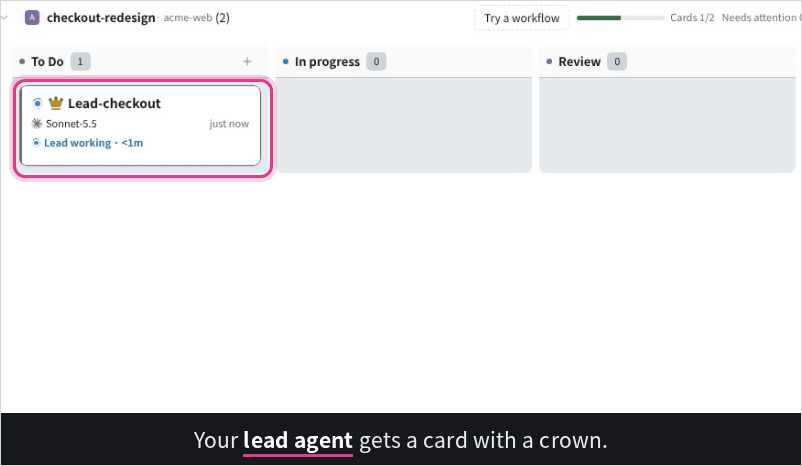
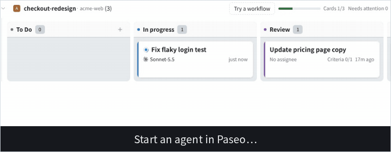
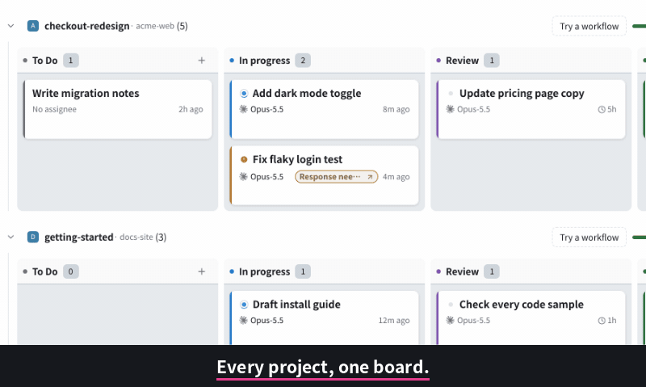
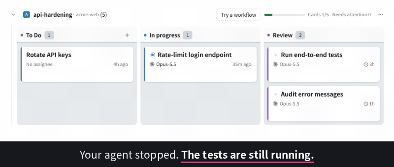

# paseo-auto-kanban (resumen en español)

[English](README.md) · [한국어](README.ko.md) · [日本語](README.ja.md) · [简体中文](README.zh-CN.md) · **Español**

**Un tablero de tareas (Board) de Paseo que tus agentes actualizan por sí mismos.**

<picture>
  <source media="(prefers-color-scheme: dark)" srcset="https://raw.githubusercontent.com/dominic4us/paseo-auto-kanban/main/docs/images/lead-dark.gif">
  
</picture>

<picture>
  <source media="(prefers-color-scheme: dark)" srcset="https://raw.githubusercontent.com/dominic4us/paseo-auto-kanban/main/docs/images/hero-dark.gif">
  
</picture>

```sh
paseo plugin install npm:paseo-auto-kanban
```

Requiere Paseo 0.9.0 o posterior. Tras instalarlo, activa **Ajustes (Settings) → Plugins → Enable plugins**. Consulta los pasos en [Instalación](#instalación).

Encontrarás más información en el [README en inglés](README.md) y en [docs/reference.md](docs/reference.md). Este documento es un resumen breve.

Al crear un agente en Paseo, aparece una tarjeta (Card) en el tablero de ese espacio de trabajo. La tarjeta se mueve mientras el agente trabaja,
queda a la espera de tu respuesta (Needs you) cuando necesita un permiso y espera en revisión (Review) cuando se detiene. Que un agente se haya detenido
no significa que el trabajo esté terminado: tú decides cuándo darlo por hecho. Los agentes líderes también pueden crear tarjetas
y vincular a los agentes responsables con el comando `kanban`. Los tableros se guardan en archivos locales del equipo que ejecuta el servidor de Paseo.
El propio plugin no recopila datos de uso. Su única conexión externa propia es la comprobación de versiones nuevas: como máximo una vez al día pregunta al registro de npm solo el número de la última versión (sin enviar el contenido de tableros o tarjetas ni datos tuyos), y puedes desactivarla en los ajustes. Sin embargo, siguiendo el funcionamiento habitual de Paseo, el tablero se
muestra en las aplicaciones de Paseo que conectes. Cuando confirmas el envío de una tarjeta a un agente, su contenido se
transmite a ese agente y, por tanto, a su proveedor de modelos.

## Por qué usarlo

Cuando ejecutas varios agentes en varios proyectos, siempre surgen las mismas preguntas: qué hace cada uno, quién espera mi respuesta
y qué ha terminado de verdad. Paseo muestra las conversaciones; este plugin muestra el trabajo. Puedes ver todos los proyectos en una pantalla,
y el contador «Requiere atención (Needs attention)» solo incluye lo que necesita una intervención humana.

<picture>
  <source media="(prefers-color-scheme: dark)" srcset="https://raw.githubusercontent.com/dominic4us/paseo-auto-kanban/main/docs/images/overview-dark.gif">
  
</picture>

Aunque un agente se haya detenido, puede que las pruebas o una compilación sigan ejecutándose. Marca la tarjeta como ocupada
(`kanban card busy CARD "Testing"`) y su borde se volverá discontinuo; al cabo de dos horas se volverá naranja para pedir tu atención.
Puedes consultar y quitar la marca desde los detalles de la tarjeta.

<picture>
  <source media="(prefers-color-scheme: dark)" srcset="https://raw.githubusercontent.com/dominic4us/paseo-auto-kanban/main/docs/images/busy-dark.gif">
  
</picture>

## Instalación

Primero comprueba las versiones en un terminal del equipo que ejecuta el servidor de Paseo (daemon).

```sh
paseo --version
node -v
```

La instalación desde npm requiere Paseo **0.9.0 o posterior** (0.8.x solo permite instalar desde una carpeta o Git). El comando opcional `kanban` requiere
Node.js **22 o posterior**.

1. En el mismo terminal, con el mismo usuario que ejecuta el servidor de Paseo:

   ```sh
   paseo plugin install npm:paseo-auto-kanban
   ```

   O desde Git, indicando una etiqueta de versión:

   ```sh
   paseo plugin install https://github.com/dominic4us/paseo-auto-kanban --ref v0.2.5
   ```

   Ambas opciones instalan el mismo plugin. El paquete npm se publica desde 0.2.1 y Paseo lo instala sin ejecutar scripts del paquete.
   Para instalar desde npm, el equipo del servidor de Paseo debe tener `npm`. Antes de instalar aparece una advertencia de confianza de una línea.

2. En Paseo, abre **Ajustes → Plugins** y activa **Enable plugins**. Este interruptor afecta a todos los plugins; si es la primera vez que los usas,
   puede estar desactivado. Mientras lo esté, los plugins instalados seguirán como `disabled` (`paseo plugin enable <id>` solo habilita un plugin,
   sin activar este interruptor).
3. Comprueba el estado de ejecución:

   ```sh
   paseo plugin ls
   ```

   `paseo-auto-kanban` debe aparecer como `running`. Si aparece `disabled`, el interruptor del paso 2 (o el estado de habilitación del propio plugin) está desactivado.
   Los errores de carga también aparecen en esa lista.

Entonces aparecerá **Kanban** en la barra lateral de Paseo. Al principio estará vacío porque todavía no hay ningún tablero (en pantallas anchas verás
«No boards registered yet»). **Inicia una conversación nueva en un espacio de trabajo de Paseo** para crear su tablero y la tarjeta de esa conversación
(también puedes crearlo manualmente con `kanban init`). Las conversaciones abiertas antes de instalar el plugin no se añaden al tablero.

> **Los plugins no se ejecutan en un entorno aislado (sandbox).** Este plugin se ejecuta con los permisos de acceso a archivos del servidor de Paseo y puede usar la API de agentes de Paseo.
> Antes de instalarlo, lee [qué ocurre automáticamente y cómo desactivarlo](#qué-ocurre-automáticamente-y-cómo-desactivarlo).

**Actualización**: el plugin y el comando `kanban` se instalan por separado, por lo que hay que actualizar ambos.

```sh
paseo plugin update paseo-auto-kanban
npm install -g --prefix ~/.local paseo-auto-kanban@latest
```

La segunda línea solo es necesaria si instalaste el comando `kanban` de esa forma. Si no hay una versión más reciente, la primera línea indica `up to date`.
Para una versión concreta, usa `--version <version>` en instalaciones desde npm o `--ref <tag>` en instalaciones desde Git. Repetir `install` con un ID ya instalado se rechaza.
El rango declarado de Paseo es `>=0.8.0 <1.0.0` (consulta las combinaciones realmente verificadas en la tabla de compatibilidad del README en inglés).

**Volver desde 0.2.5 o restaurar una copia de seguridad.** La primera vez que 0.2.5 lee un tablero, decide una sola vez qué tarjetas pueden seguir moviendo las tarjetas automáticas y escribe un informe junto a ellas; las tarjetas que no puede confirmar como seguras muestran **Needs a check** (requiere revisión) en su detalle y se reactivan una por una. 0.2.3 y 0.2.4 siguen leyendo todo lo que escribe 0.2.5. Antes de volver a ellas o de restaurar archivos desde una copia, detén todos los servidores de Paseo y la CLI `kanban`, y desactiva **Agent auto cards**; mantenlo desactivado en la versión anterior. Consulta [Automatic-move records](docs/reference.md#automatic-move-records-auto-control) (en inglés) para los pasos y lo que no está cubierto.

## Comando `kanban` (opcional)

```sh
npm install -g --prefix ~/.local paseo-auto-kanban
kanban --version
```

`--prefix ~/.local` instala en tu carpeta personal, por lo que no necesitas `sudo`. Si ejecutas solo `npm install -g paseo-auto-kanban` y la carpeta global de npm
pertenece a root (`/usr` o `/usr/local`, lo habitual al instalar Node.js desde apt o NodeSource), fallará con `EACCES: permission denied`.
Si `npm config get prefix` ya apunta a tu carpeta personal (por ejemplo, con nvm), el comando sin prefijo también funciona. El comando se instala en `~/.local/bin`, que Ubuntu
añade a `PATH` al iniciar sesión si la carpeta existe. Si no encuentras `kanban` justo después de instalarlo, abre un terminal nuevo o ejecuta `hash -r`.
Se instalan dos nombres para la misma herramienta: `kanban` y `paseo-kanban`.

Si una versión anterior de este plugin dejó un enlace `kanban` en `~/.local/bin` (`ls -l ~/.local/bin/kanban` muestra que apunta a una carpeta `paseo-kanban`),
elimina primero ese enlace. De lo contrario, la instalación se detendrá con `EEXIST: file already exists`. Si `kanban` pertenece a otra herramienta, no lo elimines;
usa el nombre `paseo-kanban`.

```sh
rm -f ~/.local/bin/kanban
```

Las instrucciones para compilar desde el código fuente y la descripción de los comandos están en la sección Command line del README en inglés.

## Migración desde el antiguo ID `paseo-kanban`

Desde 0.2.0, el ID del plugin es `paseo-auto-kanban`, por lo que Paseo lo considera un plugin nuevo. Los datos de los tableros no dependen del ID y se conservan.
Tras comprobar las versiones como se explica en [Instalación](#instalación), ejecuta lo siguiente con el mismo usuario que ejecuta el servidor de Paseo:

```sh
cp -a ~/paseo-kanban-data ~/paseo-kanban-data.backup
paseo plugin remove paseo-kanban
paseo plugin ls
paseo plugin install npm:paseo-auto-kanban
paseo plugin ls
```

- `remove` muestra una vez la entrada eliminada, todavía marcada como `disabled`. Al ejecutar después `paseo plugin ls`, ya no aparecerá la línea `paseo-kanban`.
  El interruptor **Enable plugins** sigue activado.
- Tras `install`, `paseo plugin ls` muestra `paseo-auto-kanban` como `running`, y la pantalla Kanban conserva los tableros y las tarjetas anteriores.
  Inicia una conversación nueva para comprobar que aparece una tarjeta como antes.
- Elimina el plugin antiguo **antes de instalar el nuevo** y no mantengas ambos habilitados. Comparten la carpeta de datos y ambos reaccionan a los eventos de los agentes,
  por lo que las tarjetas dejan de moverse correctamente. En una prueba, uno interpretó el movimiento del otro como una acción humana y dejó de mover esa tarjeta,
  que permaneció en curso (In progress) después de que su agente terminara.

Si usabas el antiguo comando `kanban` mediante un enlace en `~/.local/bin`, ese enlace dejará de funcionar al eliminar el plugin antiguo. Sustitúyelo por el paquete npm.

```sh
rm -f ~/.local/bin/kanban
npm install -g --prefix ~/.local paseo-auto-kanban
kanban --version
```

Sin la línea `rm -f`, la instalación se detendrá con `EEXIST: file already exists`. A partir de ahora, el comando `kanban` no se actualizará junto con el plugin;
actualiza ambos por separado con las dos líneas de actualización anteriores. Las pantallas que antes se mostraban en coreano (`config.json` con `"locale": "ko"` o sin línea locale)
seguirán en coreano.

## Qué ocurre automáticamente y cómo desactivarlo

Los ajustes se abren desde el botón de engranaje en la esquina superior derecha de Kanban → **Ajustes de Kanban (Kanban settings)**.

| Qué | Valor predeterminado | Cómo desactivarlo |
|---|---|---|
| Tarjetas automáticas de agentes (Agent auto cards: una tarjeta por agente de nivel superior, que se mueve según su actividad) | Activado | Ajustes → Automation → Agent auto cards, o por espacio de trabajo |
| Creación automática de tableros (solo en la carpeta de datos, al iniciar una conversación nueva en un espacio de trabajo sin tablero) | Activado | El mismo interruptor que las tarjetas automáticas |
| `PROCESS.md` en la carpeta del espacio de trabajo (solo para tableros creados con `kanban init` o con **+** en un carril vacío) | Activado | Establece `"exportEnabled": false` en `~/paseo-kanban-data/config.json` |
| Archivado automático de tarjetas terminadas (Archive finished cards: no se eliminan y pueden restaurarse) | 7 días | Ajustes → Automation → Archive finished cards → Off |
| Actualización automática (Auto refresh: solo lectura cada 4 segundos mientras la pantalla está visible) | Activado | Ajustes → Automation → Auto refresh |
| Comprobación de versiones nuevas (Check for new versions: como máximo una vez al día, cuando una pantalla de Kanban lee o actualiza los tableros, pregunta al registro de npm solo el número de la última versión; el límite de una vez al día se mantiene tras reinicios, al desactivarla y activarla y con varios servidores que comparten la carpeta de datos, porque cada intento se registra antes de hacerse; el día se mide con el reloj del ordenador: retrasarlo nunca adelanta la comprobación, adelantarlo puede hacerlo (salvo mientras una máquina Linux sigue encendida y puede leerse su reloj de arranque; si no puede leerse, decide solo la fecha, como en otros sistemas); si hay una versión más nueva, se muestra en Ajustes → About y con un punto en el engranaje durante un máximo de siete días desde la última respuesta; si falla, no avisa y vuelve a intentarlo al día siguiente, y tras siete días sin respuesta deja de mostrarse) | Activado | Ajustes → Automation → Status & refresh → Check for new versions. Una vez guardada como desactivada, no se hace ninguna solicitud. El ajuste se guarda con una copia de seguridad; si no se puede leer, no se hace ninguna solicitud hasta que vuelvas a elegir el interruptor |

Una tarjeta en borrador solo se envía a un agente cuando pulsas **Enviar (Send)** en la ventana de confirmación.

## Datos y desinstalación

Trata la carpeta de datos y cualquier `PROCESS.md` como privados: contienen los títulos y las notas de tus tarjetas.

- Carpeta de datos: `~/paseo-kanban-data` (conserva el nombre anterior para seguir usando los tableros existentes).
- El interruptor de la comprobación de nuevas versiones (y su copia de respaldo), el último intento y el número de la última versión se guardan en la carpeta de datos, en `update-check.json`, `update-check.backup.json` y `update-check-cache.json`; el último tema e idioma, y dónde abre Kanban el enlace de la barra lateral, se guardan en el almacenamiento local de la app (claves que empiezan por `paseo-kanban:`).
- Las instalaciones nuevas muestran la interfaz en inglés. Para usar coreano, añade `"locale": "ko"` a `config.json`.
  La configuración de versiones anteriores conserva el coreano.
- El nombre de la primera etapa varía según dónde se muestre. Se guarda como *Waiting*, por lo que `kanban ls` muestra `todo (Waiting)`, mientras que la interfaz en inglés
  muestra *To Do*. La segunda etapa es *In progress* en todas partes, incluidas las pestañas del teléfono (*진행* en la interfaz en coreano).
- Desinstalación: `paseo plugin remove paseo-auto-kanban`. La entrada eliminada aparece una vez como `disabled` y luego deja de aparecer en `paseo plugin ls`.
  La carpeta de datos y el `PROCESS.md` del espacio de trabajo se conservan; elimínalos manualmente si ya no los necesitas. Para quitar el comando `kanban`,
  usa `npm rm -g --prefix ~/.local paseo-auto-kanban` si lo instalaste con `--prefix ~/.local`, o
  `npm rm -g paseo-auto-kanban` si usaste solo `npm install -g`.

Licencia: [Apache-2.0](LICENSE)

Este documento ha sido traducido por IA. Si encuentras expresiones poco naturales, comunícalas mediante una [incidencia](https://github.com/dominic4us/paseo-auto-kanban/issues).
