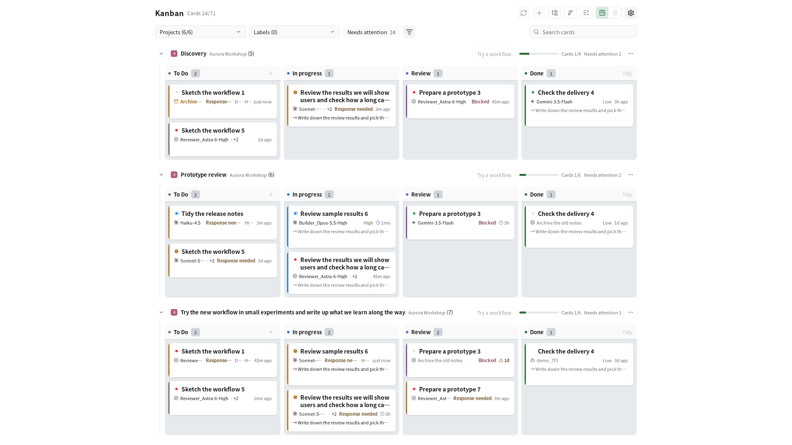
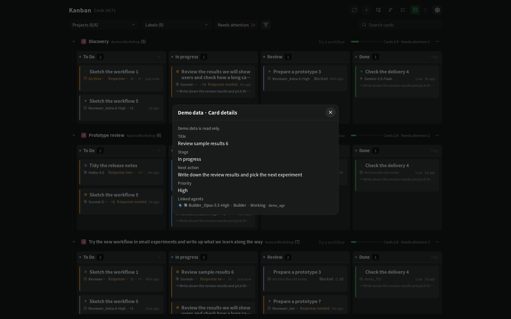
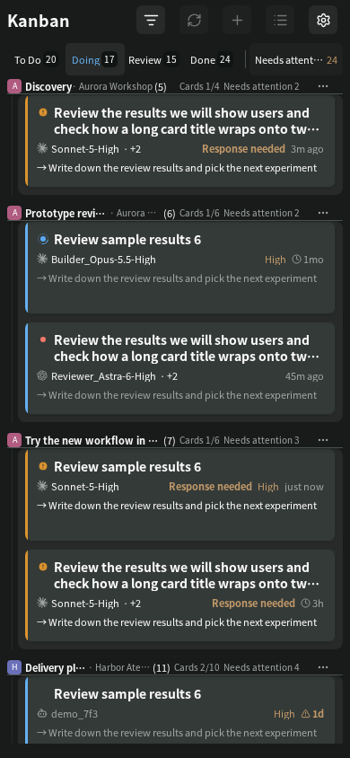

# paseo-auto-kanban

**A Paseo kanban your agents update themselves.**

Start an agent in Paseo and a card appears on that workspace's board. The card moves while the agent works,
asks for you when the agent needs a permission, and waits in Review when the agent stops — because an agent
that stopped is not the same as work that is done. You decide when a card is done.

Orchestrator agents can also manage cards themselves with the `kanban` command line tool: create cards with
acceptance criteria, link the agents they delegate to, and record deliverables. Boards are stored in local
files on the machine that runs Paseo. The plugin collects no telemetry and contacts no outside service of its
own; board contents travel only the way Paseo already works — shown in the Paseo apps you connect, and sent to
an agent (and so to that agent's model provider) when you confirm sending a card to it.



## Why

When you run several agents across several projects, the questions are always the same: what is each one
doing, which one is waiting for me, and what is actually finished? Paseo shows each chat; this plugin shows the
work. One board per workspace, every project on one screen, and a "needs you" count that only counts things
a person has to act on.

- **Automatic cards.** Every top-level agent gets a card. Turn started → In progress, permission request →
  needs you, turn ended → Review, agent archived → still Review. If you move a card yourself, it stays where
  you put it.
- **A CLI for orchestrators.** `kanban card add`, `card link`, `card move`, atomic JSON batches, safe retries.
  An optional generated `PROCESS.md` lets people and other agents read the board as plain text.
- **All projects at a glance.** Swimlanes per project and workspace, filters and search, live agent state on
  each card, automatic refresh, a phone layout, English and Korean, light and dark.




## Install

1. Run this where the Paseo server (daemon) runs:

   ```sh
   paseo plugin install npm:paseo-auto-kanban
   ```

   or, from Git at a release tag:

   ```sh
   paseo plugin install https://github.com/panto-dominic/paseo-auto-kanban --ref v0.2.1
   ```

   Both install the same plugin. The npm package is published from 0.2.1 on; Paseo installs it without running any
   package scripts.

2. In Paseo, open **Settings → Plugins** and turn on **Enable plugins**. This switch covers all plugins and can
   still be off if you have not used a plugin before; until it is on, an installed plugin stays `disabled`.
   (`paseo plugin enable <id>` turns on one plugin, not this switch.)
3. Check that it runs:

   ```sh
   paseo plugin ls
   ```

   `paseo-auto-kanban` should show `running`. `disabled` means the switch in step 2 (or the plugin's own
   enabled state) is off; a load error is shown in the same list.

A **Kanban** item then appears in the Paseo sidebar. To update later: `paseo plugin update paseo-auto-kanban`
(to a specific release: `--version <version>` for an npm install, `--ref <tag>` for a Git install; `install` again
refuses an ID that is already installed).

**Requirements:** Paseo `>=0.8.0 <1.0.0` (declared in `paseo-plugin.json`; see [compatibility](#compatibility)
for what has actually been checked). Paseo compiles the TypeScript sources itself, from either source — no build
step is needed for the plugin. An npm install needs `npm` on the Paseo server's machine. The optional CLI needs
Node.js 22 or newer; see [Command line](#command-line).

> **Plugins are not sandboxed.** Like every Paseo plugin, this one runs with the Paseo server's file system
> access and can use Paseo's agent API. Read the code before installing, and read
> [what happens automatically](#what-happens-automatically) below.

## Where your data lives

All boards live in **`~/paseo-kanban-data`** on the Paseo server's machine (override with `KANBAN_DATA_DIR`).
The folder keeps the project's earlier name, `paseo-kanban`, so boards made before the rename keep working.

| What | Where |
|---|---|
| Boards (cards, history), backups, settings | `~/paseo-kanban-data/` |
| `PROCESS.md` (generated, optional) | the workspace's own folder — see below |
| `.kanban/workflow.json` | the workspace's own folder, only when you press **Export** in the workflow view |
| Display settings (theme, screen size, board position, filters) | `~/paseo-kanban-data/ui-state.json`, per connected host |
| Last theme and language, to draw before the first read | the app's local storage, keys starting with `paseo-kanban:` |

Treat the data folder and any `PROCESS.md` as private: they contain your card titles and notes.
Details of every file are in [docs/reference.md](docs/reference.md#data-folder).

## What happens automatically

The plugin never contacts a network service and never deletes a card. These are the things it does without
you pressing a button, and how to turn each off. Settings open from the gear button at the top right of the
Kanban screen (on some phone screens, from the ⋯ menu) → **Kanban settings**.

| What | Default | Turn off |
|---|---|---|
| **Agent auto cards.** When Paseo creates a top-level agent (not a sub-agent), the server adds a card to that workspace's board and moves it on the agent's lifecycle signals. A card that already links the agent is updated instead. | On | Settings → Automation → **Agent auto cards** (the last choice saved from any device applies to the server), or per workspace under **By workspace**. Existing cards stay. |
| **Automatic boards.** A workspace with no board gets one, in the data folder, the first time a new top-level chat starts there. Chats and agents that existed before the plugin first ran never fill a board. No file is written into the workspace folder for such a board. | On (part of auto cards) | Same switches as auto cards. |
| **`PROCESS.md` in the workspace folder.** A board created with `kanban init`, or by adding the first card with **+** on an empty lane, writes `PROCESS.md` into the workspace folder and rewrites it after every change. It never overwrites a file it did not generate. Automatic boards do not get one until you run `kanban export`. | On | Set `"exportEnabled": false` in `~/paseo-kanban-data/config.json`. Existing files are kept. Consider adding `PROCESS.md` to your `.gitignore`. |
| **Archiving finished cards.** Cards that have sat in Done for the set number of days are archived (not deleted). They still count in progress and can be restored from the workspace's ⋯ → **Archived cards**. | 7 days | Settings → Automation → **Archive finished cards** → Off (or 3, 14, 30 days). |
| **Auto refresh.** While a Kanban screen is visible, it asks the server every 4 seconds which boards changed. It only reads (a check can also let the finished-card archive above run, at most every ten minutes) and pauses after 3 minutes without activity. | On | Settings → Automation → **Auto refresh**. |

Sending a card to an agent is **never** automatic: when you move a draft card to In progress, a confirmation
shows which chat will receive it, and only after you press **Send** does the server send the card to that
workspace's lead chat as a prompt (see [docs/reference.md](docs/reference.md#sending-a-draft-to-an-agent)).

The plugin also reads, without writing, Paseo's own workspace and label records under `~/.paseo/projects/`
to show names, labels and colours.

## Command line

The `kanban` CLI is optional. It lets orchestrator agents (and you) create and move cards from a terminal.
It needs Node.js 22+, no network, and no running Paseo.

```sh
npm install -g paseo-auto-kanban
kanban --version
```

The package has no runtime dependencies and runs no install scripts. To build it from source instead:

```sh
git clone https://github.com/panto-dominic/paseo-auto-kanban --branch v0.2.1
cd paseo-auto-kanban && npm ci --ignore-scripts && npm run build
npm link            # or link dist/src/cli/main.js into a folder on your PATH yourself
kanban --version
```

Check `command -v kanban` first; if another tool owns that name, use the identical `paseo-kanban` command.
Run the CLI as the same user as the Paseo server so both use the same data folder.

```sh
kanban card add --title "Review implementation" --criteria "- [ ] Findings recorded" --intent requested
kanban card link card_a1b2c3d4 --agent "$AGENT" --role reviewer --label "Review agent"
kanban card move card_a1b2c3d4 --to review
kanban ls
```

Give your orchestrator [docs/agent-guide.md](docs/agent-guide.md). The full command reference, JSON output
and retry rules are in [docs/reference.md](docs/reference.md#command-line-reference).

## Compatibility

The declared range is what Paseo lets you install, **not** what has been verified. Paseo checks it on the
server and again in each app; a version outside it is refused with the reason in Paseo's plugin settings.

| Kanban | Paseo server | App / platform | Date | What was checked |
|---|---|---|---|---|
| 0.1.46 – 0.1.64 | 0.10.2 | Web UI served by the daemon (wide and phone width) | 2026-10-02 – 10-13 | Release check of each version |
| 0.1.43 | 0.10.2 | Web UI served by the daemon (1920 and 390 wide) | 2026-10-01 | Same results before and after the Paseo update |
| 0.1.41 | 0.10.1 | Web UI served by the daemon (1920 and 390 wide) | 2026-09-30 | Same results before and after the Paseo update |
| 0.1.26 | 0.9.1 | Web UI served by the daemon | 2026-09-26 | Screens, settings, sub-card groups |
| 0.1.25 | 0.9.1 | Mobile app | 2026-09-26 | Filter sheet on a phone (manual check) |
| 0.1.8 | 0.9.1 | Mobile app 0.8.0 (Android) | 2026-09-23 | The plugin loads |
| 0.1.x | 0.9.1 | Mac app | 2026-09-20 onward | Daily use, not a structured check |
| — | 0.8.x, 0.9.2, later than 0.10.2 | any | not checked | Allowed by the range, unknown |

Rows for 0.2.0 are added after its release check. If something breaks after a Paseo update, see
[docs/paseo-release-check.md](docs/paseo-release-check.md#recovery).

## Moving from `paseo-kanban`

Earlier builds were installed under the plugin ID `paseo-kanban`. From 0.2.0 the ID is `paseo-auto-kanban`,
so Paseo treats it as a new plugin. Your boards are not tied to the ID and stay where they are.

```sh
paseo plugin remove paseo-kanban
paseo plugin install https://github.com/panto-dominic/paseo-auto-kanban --ref v0.2.1
```

Remove the old plugin **before** installing the new one, and do not keep both enabled: they would share the same
data folder and both react to every agent event.

The data folder, the `kanban` CLI, and the file format names (`paseo-kanban.workflow/…`) keep the old name.
Settings that Paseo keeps per plugin ID (enabled or disabled) start fresh.

## Uninstall

```sh
paseo plugin remove paseo-auto-kanban
```

This stops the plugin. Your data is left in place; delete it yourself if you no longer want it:

- `~/paseo-kanban-data/` (all boards, backups and settings),
- `PROCESS.md` in workspace folders, and `.kanban/workflow.json` if you exported one,
- the `kanban` command if you installed or linked it (`npm rm -g paseo-auto-kanban` after `npm install -g` or
  `npm link`, or remove your own link).

## Known limitations

- **One machine per data folder.** Boards live on the Paseo server's disk. Do not share one data folder
  between machines or containers; lock recovery relies on the local process table (automatic on Linux).
- **No drag and drop.** Move cards with the stage menu or the card detail.
- **Mobile apps** are checked less than the web UI; keyboard and safe-area behaviour may vary by device.
- **The workflow view** (beta) reads workspace folders only on a Linux server, and exporting a workflow file
  is Linux-only.
- **Language:** new installations start in English. Korean is selected with `"locale": "ko"` in
  `config.json`; there is no language switch in the settings window yet.
- **Labs:** an experimental message-folder feature exists in the code but is hidden and off; it is not
  supported.
- Paseo publishes no stability promise for its 0.x plugin API; a new Paseo release may need a plugin update.

## Documentation

- [docs/reference.md](docs/reference.md) — screens, automatic cards, settings, data files, CLI reference
- [docs/agent-guide.md](docs/agent-guide.md) — instructions to give an orchestrator agent
- [CHANGELOG.md](CHANGELOG.md) · [CONTRIBUTING.md](CONTRIBUTING.md) · [SECURITY.md](SECURITY.md)
- [README.ko.md](README.ko.md) — 한국어 요약

## License

[Apache-2.0](LICENSE). Parts of the project icon and colour logic follow Paseo (Apache-2.0); see
[NOTICE](NOTICE) and [docs/reference.md](docs/reference.md#acknowledgments).
